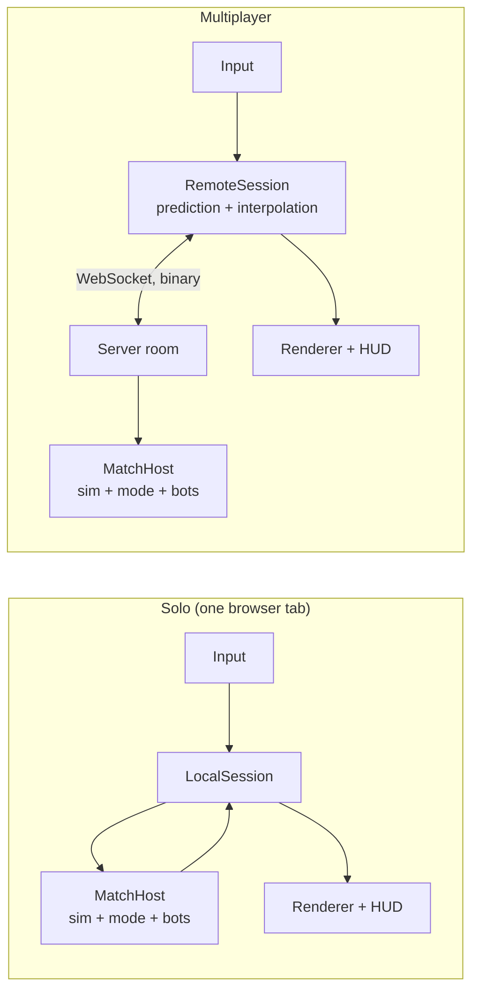
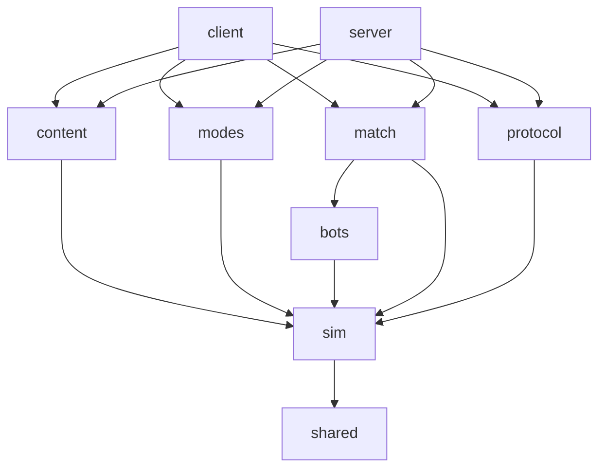

# Architecture

> **Status: proposed, awaiting the owner's approval.** Nothing described here is implemented yet.
> Once milestone 0 starts, this file describes what exists and marks clearly what is still planned.
> The reasons behind each choice are in [`decisions/`](decisions/). Open points are in [`OPEN_QUESTIONS.md`](OPEN_QUESTIONS.md).

## 1. Forces that shape the design

| Requirement (from [VISION](VISION.md)) | Architectural answer |
|---|---|
| Solo logic must later run on the server without a rewrite | A pure simulation package with no DOM, no Node APIs and no rendering, used unchanged by the browser and the server |
| Authoritative server, up to 64 participants | Server runs the simulation; clients send inputs only; per-client interest management; binary snapshots |
| Themes added with no code | Themes are data folders validated by schemas; behaviors are engine code selected and parameterized by data |
| Modes added with code, without touching the engine | A `GameMode` interface exposed by the simulation; modes live in their own package |
| Interchangeable map source | A `MapSource` interface producing engine-neutral `MapData`; Tiled is one adapter |
| Hot reload of sprites and maps | Content loaded through an asset manager that can swap resources at runtime; a dev server that pushes file changes |
| Strict palette, 960×540 integer scaling | Fixed-size render target, nearest-neighbor everywhere, palette checks on assets, optional palette-quantization pass |
| No hard-coded text, languages added as files | Every string is a translation key; locales discovered from files; the server sends keys, never text |

## 2. Runtime overview

The same **match host** (simulation + game mode + bots) runs in two places:



The renderer never talks to the simulation directly. It reads a **`WorldView`** (what to draw this frame) and a stream of **`SimEvent`s** (what just happened: shots, hits, deaths, explosions) from a **`Session`**. `LocalSession` produces them from an in-process match host; `RemoteSession` produces them from server snapshots. This seam is what lets solo work today and multiplayer arrive in milestone 3 without touching rendering or gameplay code.

## 3. Repository layout (target)

```
/
├── CLAUDE.md                 # entry point for every session
├── README.md · CHANGELOG.md · LICENSE · LICENSE-ASSETS
├── package.json              # npm workspaces, top-level scripts
├── palette/resurrect-64.gpl  # moved from the root in milestone 0
├── packages/
│   ├── shared/               # math, seeded RNG, ids, Result type, logger interface
│   ├── sim/                  # the engine: world, systems, collision, behaviors, events, GameMode API
│   ├── content/              # schemas, validation, loaders (theme files, Aseprite JSON, Tiled JSON → engine data)
│   ├── modes/                # game modes, written against the sim's public API only
│   ├── bots/                 # bot brains: perception, decisions, navigation → input commands
│   ├── match/                # MatchHost: runs a match (sim + mode + bots + participants), platform-agnostic
│   └── protocol/             # network messages, binary codec, snapshots and deltas (milestone 3)
├── apps/
│   ├── client/               # browser app: sessions, rendering, input, UI, i18n, asset manager, dev tools
│   └── server/               # Node app: HTTP + WebSocket, rooms, interest management (milestone 3)
├── themes/
│   └── vietnam/              # a theme: data only (see §8)
├── locales/                  # UI translations: en.json, fr.json, …
├── tools/                    # palette check, placeholder generator, validators, Aseprite and Tiled helpers
└── docs/                     # vision, architecture, decisions, guides, roadmap, open questions
```

Milestone 0 creates every package with its `README.md` (responsibility, allowed dependencies) and an empty public entry point, so the boundaries exist and are enforced from day one. `protocol` and `server` stay empty until milestone 3.

## 4. Modules and dependencies



| Module | Responsibility | May depend on | Must never |
|---|---|---|---|
| `shared` | Vector math, angles, seeded PRNG, ids, `Result`, logger interface | — | Import anything from the project |
| `sim` | World state, entities and components, fixed-tick systems, collision, behavior registry, events, `GameMode` API, `MapData` type | `shared`, `zod` | Use DOM, Node APIs, timers, `Math.random`, wall-clock time; know about files, Tiled, Aseprite, rendering, network |
| `content` | Theme/locale schemas, cross-reference validation, error formatting, adapters (Tiled → `MapData`, Aseprite JSON → animation sets), `FileProvider` interface | `sim`, `shared`, `zod` | Read files directly (it receives a `FileProvider`) |
| `modes` | One folder per game mode, plus the list of built-in modes | `sim` (public API) | Reach into sim internals |
| `bots` | Bot controllers that turn perception into `InputCommand`s | `sim` (public API) | Read state a bot could not perceive |
| `match` | `MatchHost`: participants, input routing, mode lifecycle, bot scheduling, tick loop driven by a clock it is given | `sim`, `bots` | Depend on a transport or a platform |
| `protocol` | Message types, binary codec, quantization, snapshot and delta encoding | `sim`, `shared` | Contain game rules |
| `apps/client` | Composition root, sessions, rendering, input, UI, i18n, asset manager, hot reload, dev pages | all packages | Contain game rules |
| `apps/server` | Composition root, rooms and codes, lobby, transport, interest management, content from disk | all packages except client | Contain game rules |

**Enforcement** (decision [0001](decisions/0001-typescript-monorepo.md)):
- Each package declares its dependencies in its `package.json`; TypeScript project references follow the same graph.
- Platform-agnostic packages compile with `lib: ["ES2023"]` and no ambient types: any use of `window`, `document` or Node built-ins fails type-checking.
- ESLint import rules forbid imports that cross the table above (for example `sim` importing `pixi.js` or a package's internal files).

## 5. Simulation core (`packages/sim`)

Decision [0002](decisions/0002-simulation-presentation-split.md).

- **Fixed tick at 60 Hz.** Time inside the simulation is counted in ticks (integers). The clock is external: the client's frame loop or the server's scheduler calls `step()`.
- **Inputs, not actions.** Every actor is driven by an `InputCommand` per tick (movement vector, aim angle, button bits). Humans and bots produce the same structure, so bots get no privileged access and the network only carries inputs upstream.
- **Entities and components.** A small custom entity-component store: entities are numeric ids; components are plain typed data (transform, velocity, collider, actor, health, inventory, projectile, map element, burning, lifetime…); systems are functions run in a fixed, documented order:
  1. apply inputs → 2. mode pre-tick → 3. movement and collision → 4. weapons (cooldowns, reload, fire) → 5. projectiles → 6. explosions, fire spread → 7. damage, status effects, deaths → 8. map element destruction → 9. mode post-tick → 10. cleanup.
- **Events.** Each tick outputs a list of `SimEvent`s (`shotFired`, `hit`, `damaged`, `killed`, `exploded`, `tileChanged`, `soundCue`…). Presentation (blood, effects, sounds), game modes and the network all consume events; none of them poll internals.
- **Determinism.** Same seed + same inputs ⇒ same state, within one JavaScript runtime. All randomness goes through seeded PRNG streams owned by the world. This gives reproducible tests, replays later, and consistent client-side prediction. Cross-machine bit-exactness is not required because the server is authoritative.
- **Coordinates.** World units are pixels at internal resolution; one tile = 48 units. An entity's position is its **ground point** (feet, base of a tree, center of a vehicle's footprint). A separate **height `z`** carries visual elevation (projectiles at gun height, grenade arcs) while collision happens on the ground plane.
- **Collision.** Custom and simple (decision [0010](decisions/0010-collision.md)): a static grid of tile flags (`solid`, `cover`, …), circle colliders for characters, axis-aligned boxes for map elements, swept segment tests for projectiles (grid traversal + segment/circle), a spatial hash for entity queries and line-of-sight raycasts.
- **Large entities.** Collider shapes are not tied to the grid: an entity may have a box spanning several tiles, and the spatial hash indexes it in every cell it touches. Oriented boxes and parent/child attachments (turrets, passengers) are planned for vehicles.
- **Behavior registry.** Weapon behaviors (`firearm`, `thrown`, `flamethrower`, …), projectile behaviors (`bullet`, `grenade`, `flame`, …) and map-element behaviors (`destructible`, `flammable`, …) are engine code. Each one registers an id and a **parameter schema**; themes pick a behavior by id and supply parameters, which are validated against that schema.
- **Visual references are ids.** The simulation knows `"character.us-rifleman"` or `"weapon.m16a1"`, never a texture. The client maps ids to loaded assets.

## 6. Match host and sessions

- **`MatchHost`** (`packages/match`) owns one match: the world, the game-mode instance, the participants (human or bot), and the bot controllers. It exposes `addParticipant`, `submitInput`, `step`, `getWorldView(forParticipant)` and the event stream. The same class runs in a browser tab for solo and in a server room online.
- **`Session`** (client side) is what the UI and renderer talk to: `sendInput`, `getWorldView(alpha)` for interpolated drawing, `onEvent`, `getModeState`.
  - `LocalSession` runs a `MatchHost` in-process (milestone 1). It can move to a Web Worker later without changing its interface (see open questions).
  - `RemoteSession` (milestone 3) sends inputs to the server, predicts the local player's movement with the same simulation code, reconciles on snapshots and interpolates other entities.

## 7. Game modes (`packages/modes`)

A mode is a folder implementing the `GameModeDefinition` interface exported by `sim`, then added to the built-in list. No change to `sim`, `match` or the apps is needed. Illustrative shape (final API defined in milestone 1):

```ts
interface GameModeDefinition<Settings> {
  id: string;                         // "team-elimination"
  nameKey: string;                    // translation key
  settings: SettingsSchema<Settings>; // validated, with defaults and label keys; drives a generic settings form
  mapRequirements: MapRequirements;   // e.g. spawn points for 2 teams, zones of type "capture"
  create(api: ModeApi, settings: Settings): GameModeInstance;
}
interface GameModeInstance {
  onMatchStart(): void;
  onTick(): void;
  onEvent(event: SimEvent): void;
  onParticipantJoined(id: ParticipantId): void;
  onParticipantLeft(id: ParticipantId): void;
  getPublicState(): ModeState;        // scores, timers, round info; replicated to clients and drawn by generic HUD widgets
}
```

`ModeApi` is the only door into the world: spawn an actor at a spawn point, put a participant into spectating, read zones, start timers, announce a message (translation key + parameters), end a round or the match.

**Theme × mode compatibility.** A mode declares what it needs from a map; the lobby only offers maps that satisfy it, and the theme validator warns when a theme has no map for a registered mode.

## 8. Themes and content (`packages/content`, `themes/`)

Decision [0006](decisions/0006-themes-as-data.md).

### 8.1 Theme folder (draft, finalized in milestone 0)

```
themes/vietnam/
├── theme.json        # manifest: id, format version, default language, factions, file references
├── characters.json   # archetypes: sprite set, collider radius, speed, hit points, default loadout
├── weapons.json      # weapon definitions: behavior id + parameters, sprite, sound cues
├── projectiles.json  # projectile definitions: behavior id + parameters, sprite, effects
├── effects.json      # visual effects: blood, explosions, muzzle flashes, flames (presentation only)
├── sounds.json       # reserved: sound cue id → file (empty until the audio milestone)
├── locales/en.json · locales/fr.json
├── sprites/<category>/<name>.aseprite · .png · .json
├── tilesets/<name>.tsj · .png (· .aseprite source)
└── maps/<name>.tmj
```

Example weapon entry (illustrative):

```json
{
  "id": "m16a1",
  "nameKey": "weapon.m16a1.name",
  "behavior": "firearm",
  "params": { "fireMode": "auto", "roundsPerMinute": 750, "damage": 28, "spreadDeg": 3,
              "magazine": 20, "reloadMs": 2200, "projectile": "rifle-bullet" },
  "sprite": "sprites/weapons/m16a1",
  "sounds": { "fire": "weapon.m16a1.fire", "reload": "weapon.m16a1.reload" }
}
```

### 8.2 Loading and validation

1. **Schema validation** of every file (Zod), with errors pointing to the file and the JSON path.
2. **Behavior parameters** validated against the schema registered by the chosen behavior.
3. **Cross-references**: projectile ids, sprite files, animation tags, tilesets, translation keys, factions.
4. **Asset rules**: frame sizes multiple of 48, required animation tags and directions present, required slices present.

Errors are collected (not thrown one by one) and printed together, for example:

```
themes/vietnam/weapons.json › weapons[2] ("m60") › params.projectile
  Unknown projectile "heavy-bulet". Known projectiles: rifle-bullet, pistol-bullet, buckshot.
```

The same validation runs in the browser (shown in a dev overlay), on the server at startup, and in the `validate:themes` command used by CI.

### 8.3 Gameplay content vs presentation content

- **Gameplay content**: weapon and projectile parameters, character stats, map collision and properties, spawn points, zones, and the few values derived from sprite metadata (muzzle offset). Loaded by both client and server.
- **Presentation content**: textures, animations, effects, fonts, translations, sounds. Loaded by the client only. The server never decodes an image.

`content` reads files through a `FileProvider` interface: `fetch` in the browser, the file system on the server and in tools, an in-memory map in tests.

## 9. Maps

Decision [0008](decisions/0008-tiled-maps.md).

- **`MapSource`** (interface): `load(request) → MapData`. Milestone 1 ships `TiledMapSource`; milestone 5 adds a procedural generator in its own package. Nothing else depends on Tiled.
- **`MapData`** (defined in `sim`): size in tiles, tile layers referencing a tile catalog (gameplay flags + visual reference), placed objects (map elements with their behavior parameters), spawn points per team, zones (rectangles/polygons with a type), and visual-only layers.
- **Tiled conventions (draft):** maps saved directly as Tiled JSON (`.tmj`), external tilesets (`.tsj`), 48×48 orthogonal tiles. Layer roles declared with Tiled's *class* field:
  - `ground` tile layers: drawn below everything; carry tile flags.
  - `objects` object layer: tile objects (trees, huts, sandbags) sorted by their base; collision footprints from Tiled's collision editor.
  - `overhead` tile layer: always drawn on top (canopy, roofs).
  - `gameplay` object layer: `spawn` points (with `team`), `zone` shapes (with `zoneType`); not drawn.
- **Gameplay properties in Tiled:** set on tileset tiles (defaults) and overridable per object: `solid`, `cover`, `hp`, `flammable`, `destroyedTile`, … A Tiled project file in `tools/tiled/` defines these as typed custom classes, **generated from the engine's schemas** so Tiled and the engine never drift apart.

## 10. Sprites and animation

Decision [0007](decisions/0007-aseprite-pipeline.md). Convention draft, finalized in the "create a sprite" guide during milestone 0:

- **One Aseprite file per visual entity**, exported next to its source as `<name>.png` + `<name>.json` (both committed, so the game builds without Aseprite).
- **Tags** = animations. Name: `<action>.<direction>` for directional animations, `<action>` otherwise. Actions in lowercase kebab-case (`idle`, `walk`, `death`, `throw`, …).
- **Directions drawn**: `down`, `down-side`, `side`, `up-side`, `up`. Side directions are drawn **facing right**; left-facing ones are mirrored at runtime.
- **Slices** (Aseprite slices with a pivot, keyed per frame when needed):
  - in character files: `hand`, the point where the weapon's grip attaches;
  - in weapon files (drawn pointing right): `grip`, the rotation origin, and `muzzle`, where projectiles and flashes start;
  - optional `origin` in any file: the ground point; default is the bottom-center pixel of the frame.
- **Frame durations and tag playback direction** (forward, reverse, ping-pong) come from Aseprite.

Aim angle → drawn direction:

| Screen direction | S | SE | E | NE | N | NW | W | SW |
|---|---|---|---|---|---|---|---|---|
| Drawn tag | `down` | `down-side` | `side` | `up-side` | `up` | `up-side` | `side` | `down-side` |
| Mirrored | no | no | no | no | no | yes | yes | yes |
| Weapon drawn | front | front | front | behind | behind | behind | front | front |

The weapon sprite rotates to the exact aim angle around its `grip` pivot, flipped vertically when aiming left so it never appears upside down.

## 11. Rendering (`apps/client/src/render`)

Decision [0003](decisions/0003-rendering-pixijs.md).

- **PixiJS** renders into a **960×540** canvas; the canvas is upscaled by CSS with the **largest integer factor** that fits, with `image-rendering: pixelated`, computed in device pixels. All textures use nearest-neighbor sampling; the camera snaps to whole pixels.
- Rotating the weapon at internal resolution keeps every pixel a palette color (no interpolation happens).
- **Layers:** ground (tile chunks baked to textures, re-baked when a tile changes; blood decals painted into them), **y-sorted world layer** (characters, map elements, multi-tile objects, corpses; sort key = ground y), overhead layer, screen-space effects, HUD.
- **Interpolation:** the renderer draws the `WorldView` interpolated between the last two ticks, so 60 Hz simulation looks smooth at 144 Hz.
- **Camera:** follows the local player with a look-ahead toward the cursor.
- **Effects** (blood sprays, muzzle flashes, smoke, casings) are client-side particles driven by `SimEvent`s; they have no gameplay effect and are never sent over the network.
- **Palette at runtime:** assets are strictly in palette. A final full-screen pass that snaps every pixel to the nearest Resurrect 64 color is planned as an option, so blending effects (fades, smoke, transparency) stay in palette. See open questions.

## 12. UI and languages

Decisions [0004](decisions/0004-ui.md) and [0009](decisions/0009-i18n.md).

- **Menus** (main menu, solo setup, lobby, settings, room code entry) are DOM, built with Preact, scaled with the same integer factor.
- **HUD** (health, ammo, grenades, kill feed, scores, timers, names) is drawn by PixiJS at internal resolution with a bitmap pixel font, so it is pixel-exact and in palette.
- **Translations** with i18next. UI strings in `locales/<lang>.json`; theme strings in `themes/<id>/locales/<lang>.json` (a separate namespace per theme). The language list is built from the files found; the language's display name lives inside its file. Missing keys fall back to English and are reported by `check:i18n`.
- **The server and the simulation never produce text**: they emit translation keys with parameters (`killfeed.eliminated` + killer id, victim id, weapon id); the client resolves names in the player's language.
- A **font coverage check** verifies that every character used in every locale exists in the bitmap font.
- Keyboard input uses physical key codes, so ZQSD on AZERTY and WASD on QWERTY are the same keys with no setting.

## 13. Networking (milestone 3)

Decision [0005](decisions/0005-networking.md).

- **Authoritative server.** One Node process hosts many rooms; each room runs a `MatchHost` at 60 Hz. Clients send inputs only. The server validates everything (input ranges, fire rates, message sizes, rate limits).
- **Rooms and codes.** A player creates a room and receives a short code (unambiguous alphabet, case-insensitive). Others join with the code. No accounts: a nickname and a reconnection token stored in the browser.
- **Transport:** WebSocket behind a `Transport` interface (WebTransport can replace it later). Lobby messages in JSON; gameplay messages in a compact binary format.
- **Upstream:** input commands each tick, with sequence numbers.
- **Downstream:** snapshots at 30 Hz (configurable), delta-encoded against the previous snapshot sent to that client, with quantized positions and angles, plus reliable events. Each snapshot acknowledges the last input processed.
- **Interest management from day one.** Each client receives only the entities inside its area of interest: its view rectangle (computed by the server from the same camera function the client uses, never trusted from the client) plus a margin, looked up in a uniform spatial grid, with hysteresis. Global state (team counts, scores, kill feed) is sent separately at low frequency.
- **Projectiles** are sent as *fire events* (origin, angle, weapon, tick); clients simulate the visual travel and the server sends the authoritative impact. Grenades and other slow entities are replicated as entities.
- **Client:** prediction of the local player's movement with the shared simulation code, reconciliation on each snapshot, interpolation of other entities about 100 ms in the past. Lag compensation for projectiles is evaluated in milestone 3.
- **Handshake** checks protocol version and a hash of the gameplay content, so a client with stale theme files gets a clear, translated error.
- **Budget for 64 participants:** about 30 entities in view × ~10 bytes × 30 Hz ≈ 10 KB/s per client before deltas; server tick under 4 ms on average.

## 14. Bots (`packages/bots`)

Decision [0011](decisions/0011-bots.md).

- A bot is a participant whose `InputCommand`s come from a `BotController` instead of a keyboard. Same rules, same code path in solo and online.
- **Perception** is built from simulation queries limited to what the bot could see (view range, line of sight) plus what it hears (gunfire events within a radius).
- **Decisions** use a small **utility AI**: candidate actions (wander, engage, chase, take cover, reload; later flank, throw grenade, retreat) are scored by considerations; the best one runs. New behaviors are added as new actions and considerations.
- **Navigation:** A* on the tile grid with clearance for the character's radius, path smoothing, cached paths. Cover search samples nearby positions whose line of sight to the threat is blocked by a `cover` tile.
- **Cost control:** bots think at about 10 Hz, staggered across ticks; aim smoothing runs every tick. Difficulty is a set of parameters (reaction time, aim error, think rate).

## 15. Audio slots

Out of scope, but reserved: behaviors declare sound cue names (`fire`, `reload`, `explode`, …); theme entries map them to cue ids; `sounds.json` maps cue ids to files; the simulation emits `soundCue` events; the client has an `AudioSystem` that resolves cues and, for now, does nothing.

## 16. Development tooling

Decision [0012](decisions/0012-tooling.md).

- **Dev server** (Vite) serves the client, `themes/` and `locales/`, and watches them. A small plugin pushes a message for each changed file; the client's asset manager reloads it in place (textures, animation sets, maps, translations). An invalid file shows the errors in a dev overlay and keeps the last valid version. In multiplayer development, the server watches the same folders.
- **Palette check** (`check:palette`): scans every PNG; fails on any pixel whose color is not in Resurrect 64 (and, pending an open question, on partial transparency), reporting file, coordinates, color and nearest palette color.
- **Placeholder generator**: writes PNG + JSON in Aseprite's export format (same tags, directions and slices as real art), so replacing a placeholder is a file swap. Placeholders are marked in their metadata; a report lists those still in use.
- **Aseprite helpers**: an export script for all `.aseprite` files (when Aseprite is installed) and a Lua script that creates a new character file with the right size, palette, tags and slices.
- **Validators**: `validate:themes`, `check:i18n`, font coverage.
- **Dev pages** in the client: sprite viewer (all directions and animations, weapon following the mouse), collision and area-of-interest debug drawing.
- **CI** (GitHub Actions): type-check, lint, tests, validators, palette check on every push.

## 17. Testing

- **Vitest** for all packages.
- **Simulation tests** build tiny worlds from ASCII maps written in the test (`#` wall, `c` cover, `S` spawn…), feed scripted inputs and assert on state and events.
- **Determinism test:** same seed and inputs → identical state hash after thousands of ticks.
- **Headless full matches:** bot-only matches run in Node and must end with a winner within a time limit.
- **Content tests:** broken fixture themes must produce the expected error messages.
- **Protocol tests:** encode/decode round trips, including randomized inputs.
- **Client:** unit tests for asset parsing, direction mapping and i18n; a browser smoke test (Playwright) from milestone 1.
- **Load tests** (milestone 3–4): headless clients and bots against a real server; tick time and bandwidth measured.

## 18. Performance budgets

| Item | Budget |
|---|---|
| Client frame | 60 FPS at internal resolution with 64 actors on screen on the reference machine (see open questions) |
| Simulation tick (server, 64 participants incl. bots) | < 4 ms average, < 8 ms p99 (tick period 16.7 ms) |
| Downstream per client | < 20 KB/s average at 64 participants |
| Upstream per client | < 3 KB/s |

## 19. Technology summary

| Area | Choice | Main reason | Record |
|---|---|---|---|
| Language, repo | TypeScript (strict), npm workspaces, Node.js LTS (≥ 24) | One language for client, server and shared simulation; typed boundaries between packages | [0001](decisions/0001-typescript-monorepo.md) |
| Simulation | Custom fixed-tick ECS-style core, pure TypeScript | Must run identically in browser and server; full control of serialization and determinism | [0002](decisions/0002-simulation-presentation-split.md) |
| Rendering | PixiJS v8 | Fast batched 2D renderer and nothing more: no physics or game loop to fight | [0003](decisions/0003-rendering-pixijs.md) |
| UI | Preact (DOM menus) + PixiJS (HUD) | Forms and text input in DOM; pixel-exact HUD in canvas | [0004](decisions/0004-ui.md) |
| Network | WebSocket (`ws`), custom binary protocol, authoritative server | Works everywhere; full control over interest management and deltas | [0005](decisions/0005-networking.md) |
| Content | JSON + Zod schemas, behavior registry | Clear validation errors; editor autocompletion via generated JSON Schema | [0006](decisions/0006-themes-as-data.md) |
| Sprites | Aseprite JSON export, tags and slices convention | Native Aseprite features; no custom exporter | [0007](decisions/0007-aseprite-pipeline.md) |
| Maps | Tiled JSON, typed custom properties, `MapSource` interface | Tiled saves JSON natively; typed properties generated from engine schemas | [0008](decisions/0008-tiled-maps.md) |
| Languages | i18next | Namespaces fit themes; plurals and interpolation built in | [0009](decisions/0009-i18n.md) |
| Collision | Custom grid + spatial hash + swept tests | Top-down shooter needs only simple shapes; deterministic and cheap on the server | [0010](decisions/0010-collision.md) |
| Bots | Utility AI + A* on the grid, input-producing controllers | Easy to extend action by action; same rules as humans | [0011](decisions/0011-bots.md) |
| Tooling | Vite, Vitest, ESLint + Prettier, tsx, esbuild, GitHub Actions | Fast dev server with hot reload hooks; one test runner for everything | [0012](decisions/0012-tooling.md) |
| Licenses | MIT (code), CC BY 4.0 (assets) | Permissive, widely understood; attribution for art | [0013](decisions/0013-licensing.md) |
