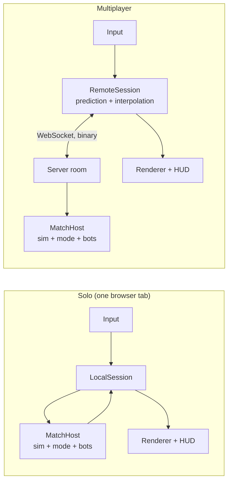
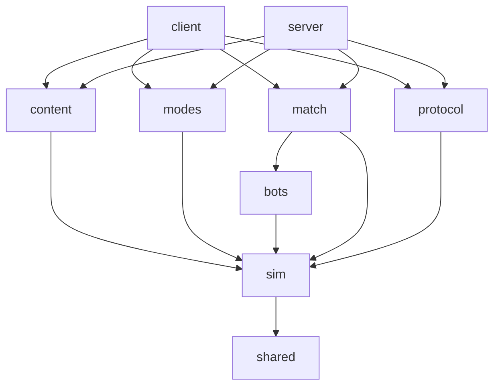

# Architecture

> **Status: accepted on 2026-11-03; milestones 0 and 1 implemented.** §0 says what exists; sections describing later milestones are marked *planned*.
> The reasons behind each choice are in [`decisions/`](decisions/). Open points are in [`OPEN_QUESTIONS.md`](OPEN_QUESTIONS.md).

## 0. What exists (end of milestone 1)

| Area | State | Where |
|---|---|---|
| Workspace, boundaries | Every package exists; boundaries enforced by `tsc -b` and lint, proven by a test | `packages/*`, `apps/*`, `tools/`, `tsconfig/`, `eslint.config.js` |
| `shared` | Vectors, angles and octants, seeded RNG, `Result` | `packages/shared/src/` |
| `sim` | World core: `createSimulation` (entity-component stores, 60 Hz `step()`, input commands, events, named random streams, state hash); `MapData` and the collision grid (tile flags `solid`, `impassable`, `cover`; object footprints); ASCII maps for tests; behavior registry and the `firearm` parameter schema. Movement with acceleration (Q19), sliding collision against tiles and footprints, separation between characters (Q48), actor spatial hash, segment casts and line of sight; `firearm` weapon and `bullet` projectile behaviors; damage, deaths and corpses; determinism proven over 10,000 ticks; the game-mode API; map replacement for hot reload | `packages/sim/src/` |
| `content` | Theme loading and validation (manifest, characters with gameplay values, weapons, projectiles, effects), conversion of a theme into the simulation catalog (`buildCatalog`), Tiled maps (`loadMap`, `MapSource`), Aseprite sprite sheets, sprite conventions, animation timing, translation files, palette, content index, JSON Schemas | `packages/content/src/` |
| `match` | `createMatchHost`: participants, inputs, bots, mode lifecycle, kills and deaths, `WorldView` | `packages/match/src/` |
| `modes` | Game-mode API in `sim` (`GameModeDefinition`, `ModeApi`, `ModeState`); `team-elimination` (Q21, Q51) and `sandbox` (development only) | `packages/sim/src/modes/`, `packages/modes/src/` |
| `bots` | Perception (sight, hearing, memory), navigation (A*, path smoothing), utility-AI brain (engage, reload, chase, wander) with easy / normal / hard difficulty; run by the match host for `bot` participants | `packages/bots/src/` |
| `protocol`, `apps/server` | Empty entry points | — |
| Client | 960×540 integer-scaled renderer, content store, character and sheet views, translations, Preact interface layer, menus (main menu, solo setup, settings, pause, end of match), sprite viewer (`/dev/sprites`), hot reload of themes and languages; `LocalSession` (fixed 60 Hz step, interpolation), match input (physical keys, mouse aim), world rendering (map chunks, depth-sorted world layer, interpolation, centered camera), event-driven effects, HUD with its bitmap font, test scene (`/dev/scene`); the content store also loads maps and tileset images | `apps/client/` |
| Tools | Palette check, theme validation (themes, catalogs, maps), generated files (JSON Schemas, Tiled project, behavior reference), i18n and font check, HUD font generator, placeholder generator (art, tilesets, maps), headless bot benchmark, Aseprite export, Lua character template | `tools/` |
| Content | Vietnam theme (2 factions, 2 characters, 2 rifles, a rifle bullet, 5 effects, the `river-village` map with its 3 tilesets (ground tiles, a tree and sandbags as tile objects), placeholder art, EN/FR texts); `example` theme (Red and Blue, one rifle, a 40×30 arena, Q60), added as files only; EN/FR interface | `themes/vietnam/`, `themes/example/`, `locales/` |
| CI | `npm run check` (with coverage thresholds) + REUSE + Playwright smoke test on GitHub Actions | `.github/workflows/check.yml` |

## 1. Forces that shape the design

| Requirement (from [VISION](VISION.md)) | Architectural answer |
|---|---|
| Solo logic must later run on the server without a rewrite | A pure simulation package with no DOM, no Node APIs and no rendering, used unchanged by the browser and the server |
| Authoritative server, up to 64 participants | Server runs the simulation; clients send inputs only; per-client interest management; binary snapshots |
| Themes added with no code | Themes are data folders validated by schemas; behaviors are engine code selected and parameterized by data |
| Modes added with code, without touching the engine | A `GameMode` interface exposed by the simulation; modes live in their own package |
| Interchangeable map source | A `MapSource` interface producing engine-neutral `MapData`; Tiled is one adapter |
| Hot reload of sprites and maps | Content loaded through an asset manager that can swap resources at runtime; a dev server that pushes file changes |
| Strict palette, 960×540 integer scaling | Fixed-size render target, nearest-neighbor everywhere, palette checks on assets, optional palette-quantization pass |
| No hard-coded text, languages added as files | Every string is a translation key; locales discovered from files; the server sends keys, never text |

## 2. Runtime overview

The same **match host** (simulation + game mode + bots) runs in two places:



The renderer never talks to the simulation directly. It reads a **`WorldView`** (what to draw this frame) and a stream of **`SimEvent`s** (what just happened: shots, hits, deaths, explosions) from a **`Session`**. `LocalSession` produces them from an in-process match host; `RemoteSession` produces them from server snapshots. This seam is what lets solo work today and multiplayer arrive in milestone 3 without touching rendering or gameplay code.

## 3. Repository layout (target)

```
/
├── CLAUDE.md                 # entry point for every session
├── README.md · CHANGELOG.md · LICENSE · LICENSE-ASSETS
├── package.json              # npm workspaces, top-level scripts
├── tsconfig.json             # solution file: references every package
├── tsconfig/                 # shared compiler settings: base, agnostic (no platform), browser, node
├── palette/resurrect-64.gpl  # the Resurrect 64 palette
├── packages/
│   ├── shared/               # math, seeded RNG, ids, Result type, logger interface
│   ├── sim/                  # the engine: world, systems, collision, behaviors, events, GameMode API
│   ├── content/              # schemas, validation, loaders (theme files, Aseprite JSON, Tiled JSON → engine data)
│   ├── modes/                # game modes, written against the sim's public API only
│   ├── bots/                 # bot brains: perception, decisions, navigation → input commands
│   ├── match/                # MatchHost: runs a match (sim + mode + bots + participants), platform-agnostic
│   └── protocol/             # network messages, binary codec, snapshots and deltas (milestone 3)
├── apps/
│   ├── client/               # browser app: sessions, rendering, input, UI, i18n, asset manager, dev tools
│   └── server/               # Node app: HTTP + WebSocket, rooms, interest management (milestone 3)
├── themes/
│   └── vietnam/              # a theme: data only (see §8)
├── locales/                  # UI translations: en.json, fr.json, …
├── tools/                    # palette check, placeholder generator, validators, Aseprite and Tiled helpers
└── docs/                     # vision, architecture, decisions, guides, roadmap, open questions
```

Milestone 0 creates every package with its `README.md` (responsibility, allowed dependencies) and an empty public entry point, so the boundaries exist and are enforced from day one. `protocol` and `server` stay empty until milestone 3.

## 4. Modules and dependencies



| Module | Responsibility | May depend on | Must never |
|---|---|---|---|
| `shared` | Vector math, angles, seeded PRNG, ids, `Result`, logger interface | — | Import anything from the project |
| `sim` | World state, entities and components, fixed-tick systems, collision, behavior registry, events, `GameMode` API, `MapData` type | `shared`, `zod` | Use DOM, Node APIs, timers, `Math.random`, wall-clock time; know about files, Tiled, Aseprite, rendering, network |
| `content` | Theme/locale schemas, cross-reference validation, error formatting, adapters (Tiled → `MapData`, Aseprite JSON → animation sets), `FileProvider` interface | `sim`, `shared`, `zod` | Read files directly (it receives a `FileProvider`) |
| `modes` | One folder per game mode, plus the list of built-in modes | `sim` (public API), `zod` | Reach into sim internals |
| `bots` | Bot controllers that turn perception into `InputCommand`s | `sim` (public API) | Read state a bot could not perceive |
| `match` | `MatchHost`: participants, input routing, mode lifecycle, bot scheduling, tick loop driven by a clock it is given | `sim`, `bots` | Depend on a transport or a platform |
| `protocol` | Message types, binary codec, quantization, snapshot and delta encoding | `sim`, `shared` | Contain game rules |
| `apps/client` | Composition root, sessions, rendering, input, UI, i18n, asset manager, hot reload, dev pages | all packages | Contain game rules |
| `apps/server` | Composition root, rooms and codes, lobby, transport, interest management, content from disk | all packages except client | Contain game rules |

**Enforcement** (decision [0001](decisions/0001-typescript-monorepo.md)):
- Each package declares its dependencies in its `package.json`; TypeScript project references follow the same graph.
- Platform-agnostic packages compile with `lib: ["ES2023"]` and no ambient types: any use of `window`, `document` or Node built-ins fails type-checking.
- ESLint import rules (`eslint.config.js`), **generated from each package's declared dependencies**, forbid imports that cross the table above: an undeclared project package, a deep import into another package's files, a Node or presentation library in a platform-agnostic package, PixiJS outside `apps/client/src/render`.
- Test files may also import Node (to read fixtures) and the packages declared as `devDependencies`: `modes` tests run modes inside a real `match` host, which production code of `modes` may not import.

## 5. Simulation core (`packages/sim`) — *implemented in milestone 1; later behaviors planned*

Decision [0002](decisions/0002-simulation-presentation-split.md).

**What exists:** `createSimulation({ map, catalog, seed, rules })` returns a `Simulation` (`src/world/simulation.ts`): `spawnActor`, `removeActor`, `step(inputs)` returning the tick's events, read-only `actor`/`actors`, and `hash()`. Internally (`src/world/state.ts`) each component kind (`position`, `velocity`, `body`, `actor`, `health`) has its own store (`src/core/entities.ts`); systems (`src/world/systems.ts`) are functions over that state. The `Catalog` (`src/world/catalog.ts`) holds the gameplay content in engine units. Inputs are sanitized before use (`src/core/input.ts`); an actor with no input for a tick stands still and keeps its aim. Events produced between two steps (a spawn by the game mode) are returned by the next step.

**Movement and collision (exist):** the movement system (`src/systems/movement.ts`) accelerates each actor toward the velocity its input asks for (full speed in 0.08 s, Q19), moves its circle with `moveCircle` (`src/physics/move-circle.ts`: sub-moves of at most half the radius, pushed out of blocking tiles and footprints; a sub-move that cannot be resolved is cancelled, so a character never ends inside an obstacle), then pushes overlapping actors apart, half each (Q48). The actor spatial hash (`src/physics/spatial-hash.ts`, one-tile cells) is rebuilt after movement. `castSegment` and `lineOfSight` (`src/physics/raycast.ts`) traverse the grid tile by tile and test footprints in each tile crossed.

**Weapons and projectiles (exist):** each actor holds the default weapon of its character (Q17). The weapons and projectiles systems (`src/systems/combat.ts`) run, for each weapon or projectile, the updater of the behavior its catalog entry names: `firearm` (`src/behaviors/weapons/firearm.ts`: auto or semi fire, a fractional cooldown so any rate of fire is exact, spread drawn from the world's `weapons` random stream, magazine, reload on the button or when empty, spare magazines) and `bullet` (`src/behaviors/projectiles/bullet.ts`). A shot first traces from the shooter's ground point to the muzzle, so nobody fires through a wall they touch; a bullet then sweeps the segment it travels each tick (`src/world/trace.ts`) and stops at the first obstacle with the `solid` flag or character it meets: never its shooter, teammates only with friendly fire (Q49). Projectiles fly at the character's gun height `z`, used only for drawing. Events: `shotFired`, `reloadStarted`, `reloaded`, `projectileImpact`, `hit`.

**Loadouts and grenades (exist):** a character has a primary weapon and may carry a throwable with a count per life (Q61): the `throw` button throws one per press, after a short pause (`thrown`, `src/behaviors/weapons/thrown.ts`). `InputCommand.aimDistance` says how far the cursor is, from the hands: the `grenade` projectile (`src/behaviors/projectiles/grenade.ts`) lands there, up to the weapon's maximum range (Q30). Its height `z` follows an arc computed to touch the ground at the target; it then bounces and rolls to a stop, and goes off when its fuse ends, counted from the throw. It bounces off `solid` obstacles, flies over `cover` above 16 px and hits it below, and passes characters. `SegmentHit` gives the normal of the side met. A grenade going off pushes an explosion, with its thrower as owner even after death.

**Explosions (exist):** the explosion system (`src/systems/explosions.ts`, step 6) handles the explosions queued during the tick and emits `exploded`. Each character within the radius takes the center damage falling linearly to 0 at the radius, unless `solid` or `cover` stands between the center and the character's ground point (Q65; what the center is inside of, cover under a grenade going off in the air, does not count). The owner is always hurt, teammates only with friendly fire on (Q64). `Simulation.explode` sets one off directly for development scenes and tests.

**Map elements (exist):** tiles and objects with element properties in `MapData` (`hp`, `damageFilter`, `explosive`, a destroyed variant; Q33) are `MapElement`s (`src/world/elements.ts`): the map itself stays immutable, the current tiles of each layer are kept there and the collision grid follows them. Bullets and blasts queue damage for the element they reach; the map element system (`src/systems/map-elements.ts`, step 8) applies it within the damage filter. At 0 hit points a tile becomes its destroyed variant (`tileChanged`), an object loses its footprints, and `elementDestroyed` reports it; an explosive element then goes off in the next tick's step 6, with the destroyer as owner. A blast reaches an element unless another obstacle stands before its nearest point. `clear` (a new round) restores everything and reports `mapReset`. The match host keeps bot navigation current from these events.

**Fire and the flamethrower (exist):** the `flamethrower` weapon (`src/behaviors/weapons/flamethrower.ts`) throws `flame` projectiles (`src/behaviors/projectiles/flame.ts`) while its tank lasts, then refills; `rounds` counts the tank in ticks of fire. A flame hurts and ignites the character it hits, ignites what it flies over and what it stops against, and stops at obstacles, cover included unless the flamethrower reaches over it. Flammable tiles (of any layer, overhead included) and objects burn as map elements, for the time given by the catalog's `fire` values (Q63, Q70): each second they may catch adjacent flammable elements, drawn from the world's `fire` random stream, and burn out into their burnt variant, by way of step 8. The fire system (`src/systems/fire.ts`, step 6) also ignites characters standing in a fire and removes the hit points of burning ones (`burning` component, exact over time). A fire keeps its origin as it spreads: its damage counts for whoever started it, who is hurt by it too, teammates only with friendly fire on (Q64). Events: `fireStarted`, `fireEnded`.

**Damage and deaths (exist):** a `hit` or an explosion queues its damage, tagged with its source (`bullet`, `explosion`, `fire`); the damage system (`src/systems/damage.ts`, step 7) removes it from the target's hit points (Q15) and emits `damaged`, then `killed` (victim, killer, weapon, source, position) at 0. A dead actor (`alive: false`) is a corpse (Q28): it ignores input, leaves the actor index, so it blocks nobody and cannot be hit, and stays until the game mode removes it.

- **Fixed tick at 60 Hz.** Time inside the simulation is counted in ticks (integers). The clock is external: the client's frame loop or the server's scheduler calls `step()`.
- **Inputs, not actions.** Every actor is driven by an `InputCommand` per tick (movement vector, aim angle, button bits). Humans and bots produce the same structure, so bots get no privileged access and the network only carries inputs upstream.
- **Entities and components.** A small custom entity-component store: entities are numeric ids; components are plain typed data (transform, velocity, collider, actor, health, inventory, projectile, map element, burning, lifetime…); systems are functions run in a fixed, documented order:
  1. apply inputs → 2. mode pre-tick → 3. movement and collision → 4. weapons (cooldowns, reload, fire) → 5. projectiles → 6. explosions, fire spread → 7. damage, status effects, deaths → 8. map element destruction → 9. mode post-tick → 10. cleanup.
- **Events.** Each tick outputs a list of `SimEvent`s (`shotFired`, `hit`, `damaged`, `killed`, `exploded`, `tileChanged`, `soundCue`…). Presentation (blood, effects, sounds), game modes and the network all consume events; none of them poll internals.
- **Determinism.** Same seed + same inputs ⇒ same state, within one JavaScript runtime. All randomness goes through seeded PRNG streams owned by the world. This gives reproducible tests, replays later, and consistent client-side prediction. Cross-machine bit-exactness is not required because the server is authoritative.
- **Coordinates.** World units are pixels at internal resolution; one tile = 48 units. An entity's position is its **ground point** (feet, base of a tree, center of a vehicle's footprint). A separate **height `z`** carries visual elevation (projectiles at gun height, grenade arcs) while collision happens on the ground plane.
- **Collision.** Custom and simple (decision [0010](decisions/0010-collision.md)): a grid of tile flags, changed only by map elements (`solid`, `cover`, …), circle colliders for characters, axis-aligned boxes for map elements, swept segment tests for projectiles (grid traversal + segment/circle), a spatial hash for entity queries and line-of-sight raycasts.
- **Large entities.** Collider shapes are not tied to the grid: an entity may have a box spanning several tiles, and the spatial hash indexes it in every cell it touches. Oriented boxes and parent/child attachments (turrets, passengers) are planned for vehicles.
- **Behavior registry** (`src/behaviors/`, exists since M0). Weapon behaviors (`firearm`, `thrown`, `flamethrower`, …), projectile behaviors (`bullet`, `grenade`, `flame`, …) and map-element behaviors (`destructible`, `flammable`, …) are engine code. Each one registers an id and a **parameter schema**; themes pick a behavior by id and supply parameters, which are validated against that schema.
- **Visual references are ids.** The simulation knows `"character.us-rifleman"` or `"weapon.m16a1"`, never a texture. The client maps ids to loaded assets.

## 6. Match host and sessions — *implemented in milestone 1; `RemoteSession` planned for milestone 3*

- **`MatchHost`** (`packages/match/src/match-host.ts`, exists) owns one match: the simulation, the game-mode instance, the participants (human or bot) and the bot brains. `createMatchHost({ map, catalog, mode, settings, seed })` validates the mode settings and derives the simulation rules from them; the host exposes `addParticipant`, `removeParticipant`, `start`, `submitInput` (a human's input holds until replaced), `step` (one tick: simulation, then the mode's `onEvent` for each event and its `onTick`; returns the events) and `view()`, the `WorldView` presentation draws: actors, projectiles, participants with their character, kills and deaths, and the mode state. It implements the `ModeApi`: `spawn` places a character on a random free spot of the team's spawn areas (the match's `spawns` random stream) facing the middle of the map. The same code runs in a browser tab for solo and in a server room online. Per-participant views (`forParticipant`, interest management) arrive with multiplayer.
- **`Session`** (client side, `apps/client/src/session/session.ts`, exists) is what the UI and renderer talk to: `sendInput` (held until replaced), `advance(deltaMs)` (lets real time pass and returns the events of the ticks run), `frame()` (the two latest `WorldView`s and the interpolation factor between them) and `paused`.
  - `LocalSession` (`local-session.ts`, exists) runs a `MatchHost` in-process with a fixed-step accumulator: 60 ticks per second whatever the frame rate, at most 250 ms of catch-up after a stall (a hidden tab), nothing while paused. It can move to a Web Worker later without changing its interface (Q47).
  - `RemoteSession` (milestone 3) sends inputs to the server, predicts the local player's movement with the same simulation code, reconciles on snapshots and interpolates other entities.

## 7. Game modes (`packages/modes`) — *implemented in milestone 1; further modes in milestone 5*

A mode is a folder implementing the `GameModeDefinition` interface exported by `sim` (`packages/sim/src/modes/game-mode.ts`, exists), then added to the built-in list (`packages/modes/src/built-in.ts`). No change to `sim`, `match` or the apps is needed. The guide is [add a mode](guides/add-a-mode.md).

```ts
interface GameModeDefinition<Settings> {
  id: string;                          // "team-elimination"
  nameKey: string;                     // translation key
  settings: z.ZodType<Settings>;       // with defaults; drives a generic settings form (M4)
  mapRequirements: MapRequirements;    // { teams: 2 }: spawn areas for teams 1 and 2
  rules(settings: Settings): Partial<Rules>;  // e.g. friendly fire
  create(api: ModeApi, settings: Settings): GameModeInstance;
}
interface GameModeInstance {
  onMatchStart(): void;
  onEvent(event: SimEvent): void;      // each event of the tick
  onTick(): void;                      // then once per tick
  onParticipantJoined(id: ParticipantId): void;
  onParticipantLeft(id: ParticipantId): void;
  state(): ModeState;                  // round, timer, team scores, banner, result; drawn by generic HUD widgets
}
```

`ModeApi` is the only door into the match: the map, the tick, the participants and their characters, `spawn` (on a free spot of the team's areas), `clearWorld` (new round), `setFrozen` (countdowns: characters aim but neither move nor fire) and the mode's own random stream. Displayed texts are `DisplayText`s: a translation key with parameters, never text (§12); a parameter named `team` holds a team number, which the client shows as the team's faction name. Built-in modes: `team-elimination` (`packages/modes/src/team-elimination/`) and `sandbox`, kept out of the list offered to players. Spectating is decided by the client in M1 (the camera follows a living teammate); the server will need it for interest management in M3.

**Theme × mode compatibility.** A mode declares what it needs from a map; the lobby only offers maps that satisfy it, and the theme validator warns when a theme has no map for a registered mode.

## 8. Themes and content (`packages/content`, `themes/`)

Decision [0006](decisions/0006-themes-as-data.md).

### 8.1 Theme folder

Files have fixed names; the ones marked *planned* arrive with the milestone that needs them.

```
themes/vietnam/
├── theme.json        # manifest: id, format version, default language, factions
├── characters.json   # archetypes: sprite, speed, collider radius, hit points, default weapon, hit effect
├── weapons.json      # weapon definitions: behavior id + parameters, sprite, projectile, effects, sound cues
├── projectiles.json  # projectile definitions: behavior id + parameters, sprite, impact effect
├── effects.json      # visual effects (optional): id → sprite with a "play" animation
├── sounds.json       # planned (audio milestone): sound cue id → file
├── locales/en.json · locales/fr.json
├── sprites/<category>/<name>.aseprite · .png · .json
├── tilesets/<name>.tsj · .png (· .aseprite source)   # planned (M1)
└── maps/<name>.tmj                                  # planned (M1)
```

Example weapon entry (illustrative):

```json
{
  "id": "m16a1",
  "nameKey": "weapon.m16a1.name",
  "behavior": "firearm",
  "params": { "fireMode": "auto", "roundsPerMinute": 750, "damage": 28, "spreadDeg": 3,
              "magazine": 20, "reloadMs": 2200 },
  "sprite": "sprites/weapons/m16a1",
  "projectile": "rifle-bullet",
  "effects": { "fire": "muzzle-flash" },
  "sounds": { "fire": "weapon.m16a1.fire", "reload": "weapon.m16a1.reload" }
}
```

### 8.2 Loading and validation

1. **Schema validation** of every file (Zod), with errors pointing to the file and the JSON path.
2. **Behavior parameters** validated against the schema registered by the chosen behavior.
3. **Cross-references**: factions, weapons, projectiles, effects, sprite files, animation tags, translation keys (later: tilesets).
4. **Asset rules**: frame sizes multiple of 48, required animation tags and directions present, required slices present.

Errors are collected (not thrown one by one) and printed together, for example:

```
error: themes/vietnam/weapons.json › weapons[2] ("m60").params.magazine
  Too small: expected number to be >=1
error: themes/vietnam/characters.json › characters[0] ("us-rifleman").weapon
  Unknown weapon "m61". Known weapons (weapons.json): m16a1, ak47.
```

The loader is `loadTheme` in `packages/content/src/theme/`; its tests list every kind of problem it reports. `buildCatalog` (same folder) then turns a valid theme into the simulation's `Catalog`, measuring on the sprites how high and how far ahead each character holds its weapon (`hand` slice of the first `idle.side` frame) and each weapon's length from `grip` to `muzzle`; `validate:themes` runs it too.

The same validation runs in the browser (shown in a dev overlay), on the server at startup, and in the `validate:themes` command used by CI. Texts missing from a non-default language are warnings: the default-language text is shown instead.

### 8.3 Gameplay content vs presentation content

- **Gameplay content**: weapon and projectile parameters, character stats, map collision and properties, spawn points, zones, and the few values derived from sprite metadata (muzzle offset). Loaded by both client and server.
- **Presentation content**: textures, animations, effects, fonts, translations, sounds. Loaded by the client only. The server never decodes an image.

`content` reads files through a `FileProvider` interface: `fetch` in the browser, the file system on the server and in tools, an in-memory map in tests.

## 9. Maps — *implemented in milestone 1; zones and map elements planned*

Decision [0008](decisions/0008-tiled-maps.md).

- **`MapSource`** (interface, `packages/content/src/maps/load-map.ts`): `load(ref) → { map, issues }`. `tiledMapSource` reads a theme's Tiled files (exists); milestone 5 adds a procedural generator in its own package. Nothing else depends on Tiled.
- **`loadMap`** (exists) reads a `.tmj` map and its external `.tsj` tilesets (`src/maps/tiled-json.ts` lists the fields read) and returns `MapData` or the problems found, each naming the file, the layer, the object and its position. Maps are discovered: every `maps/*.tmj` of a theme is listed in the content index and checked by `validate:themes`. The rules for map makers are in the guide [create a map](guides/create-a-map.md).
- **`MapData`** (defined in `sim`, exists: `packages/sim/src/map/map-data.ts`): size in tiles, tile layers (`ground` with gameplay flags, `overhead` drawn on top) referencing a catalog of tile types (flags + picture), placed objects (picture, ground point, collision footprints, `low` for objects drawn below characters), spawn areas per team (Q52). Planned: zones (rectangles/polygons with a type) and map elements with behavior parameters (M2).
- **Collision grid** (`packages/sim/src/map/collision-grid.ts`): the flags of each tile combined from the ground layers, plus object footprints indexed by the tiles they touch; outside the map is solid. Flags: `solid` blocks movement, projectiles and sight; `impassable` blocks movement only (Q50); `cover` (map objects only) blocks movement, not sight, and lets projectiles through per Q29 and Q72. Each object footprint knows its object (`object`) and, for cover, its `bulletPassPercent`. `castSegment` takes an optional `passes` callback, asked about each footprint met in path order; `traceProjectile` (`src/world/trace.ts`) uses it so that a bullet passes the cover its weapon reaches over (recorded at the shot) and draws its pass chance once per cover object from the `cover` random stream (`Projectile.passed` lists the objects passed).
- **ASCII maps** (`asciiMap` in `packages/sim/src/testing/`): `#` solid, `~` impassable, `o` solid object, `s` sandbags (a cover object filling the tile, 40 % pass), `1`–`9` team spawn; used by the tests of every package.
- **Tiled conventions:** maps saved directly as Tiled JSON (`.tmj`), external tilesets (`.tsj`) based on one image, 48×48 orthogonal tiles, CSV tile data. Layer roles declared with Tiled's *class* field:
  - `ground` tile layers: drawn below everything; carry tile flags.
  - `objects` object layer: tile objects (trees, huts, sandbags) sorted by their base; collision footprints from Tiled's collision editor.
  - `overhead` tile layer: always drawn on top (canopy, roofs).
  - `gameplay` object layer: `spawn` rectangles (with `team`, Q52); later `zone` shapes; not drawn.
- **Gameplay properties in Tiled:** set on tileset tiles (defaults) and overridable per tile object: `solid`, `impassable`, `cover` with `bulletPassPercent` (tile objects only), and `low` (drawing only: the object is drawn just above the ground instead of depth-sorted) (exist); `hp`, `flammable`, `destroyedTile`, … in M2. They are defined once in `packages/content/src/maps/properties.ts`. The Tiled project file `tools/tiled/pixel-shoot.tiled-project` defines them as typed custom classes (with the layer classes and the `spawn` object class), **generated from these definitions** by `npm run schemas`, so Tiled and the engine never drift apart; `check:schemas` fails when it is stale.

## 10. Sprites and animation

Decision [0007](decisions/0007-aseprite-pipeline.md). The full convention, written for artists, is the guide [create a sprite](guides/create-a-sprite.md):

- **One Aseprite file per visual entity**, exported next to its source as `<name>.png` + `<name>.json` (both committed, so the game builds without Aseprite).
- **Tags** = animations. Name: `<action>.<direction>` for directional animations, `<action>` otherwise. Actions in lowercase kebab-case (`idle`, `walk`, `death`, `throw`, …).
- **Directions drawn**: `down`, `down-side`, `side`, `up-side`, `up`. Side directions are drawn **facing right**; left-facing ones are mirrored at runtime.
- **Slices** (Aseprite slices with a pivot, keyed per frame when needed):
  - in character files: `hand`, the point where the weapon's grip attaches;
  - in weapon files (drawn pointing right): `grip`, the rotation origin, and `muzzle`, where projectiles and flashes start;
  - optional `origin` in any file: the ground point; default is the bottom-center pixel of the frame.
- **Frame durations and tag playback direction** (forward, reverse, ping-pong) come from Aseprite.

Aim angle → drawn direction:

| Screen direction | S | SE | E | NE | N | NW | W | SW |
|---|---|---|---|---|---|---|---|---|
| Drawn tag | `down` | `down-side` | `side` | `up-side` | `up` | `up-side` | `side` | `down-side` |
| Mirrored | no | no | no | no | no | yes | yes | yes |
| Weapon drawn | front | front | front | behind | behind | behind | front | front |

The weapon sprite rotates to the exact aim angle around its `grip` pivot, flipped vertically when aiming left so it never appears upside down. Slice points and origins are pixel corners; mirroring happens around the ground point (`render/weapon-pose.ts`, `render/character-view.ts`).

On the client, the **content store** (`src/content/content-store.ts`) holds the loaded themes, every sprite sheet of each theme folder and their images, and each theme's maps with their tileset images (renderer-agnostic `ImageBitmap`s); `render/sheet-textures.ts` and `render/image-textures.ts` turn them into PixiJS textures. When a reload finds errors, the last valid version stays in use, for a whole theme or for a single map.

## 11. Rendering (`apps/client/src/render`)

Decision [0003](decisions/0003-rendering-pixijs.md).

- **PixiJS** renders into a **960×540** canvas; the canvas is upscaled by CSS with the **largest integer factor** that fits, with `image-rendering: pixelated`, computed in device pixels (`render/screen-layout.ts`, `render/renderer.ts`). In development, a test pattern (palette swatches and a 1-pixel checkerboard) shows whether scaling is crisp. All textures use nearest-neighbor sampling; the camera snaps to whole pixels.
- Rotating the weapon at internal resolution keeps every pixel a palette color (no interpolation happens).
- **Layers** (`render/world-scene.ts`, exists): ground (tile chunks of 16×16 tiles, each cached as one texture and hidden off screen, `render/map-view.ts`; blood decals painted into them in M2), low map objects (sandbags: nothing stands on them, so characters and their weapons are always drawn over them), corpses, the **depth-sorted world layer** (map objects such as trees, living characters, projectiles; draw order from `render/depth.ts`: larger ground y in front, ties by entity id), overhead tiles. Planned: screen-space effects and the HUD above them.
- **Interpolation** (exists): the scene draws the session frame interpolated between the last two ticks, so 60 Hz simulation looks smooth at 144 Hz. The local player's weapon uses the live mouse aim rather than the last tick's.
- **Camera** (exists): keeps the followed character at the exact center of the screen (Q20), snapped to whole pixels; beyond the map edges, the background color shows.
- **Looks** (`render/theme-looks.ts`): gameplay ids (characters, weapons, projectiles, effects) are turned into sprite sheets of the theme; a dead character's weapon is not drawn.
- **Effects** (`render/effects.ts`, exist for M1): client-side animations driven by `SimEvent`s, never sent over the network and with no gameplay effect: the weapon's `fire` effect at the muzzle (rotated to the shot), the projectile's `impact` effect where it stops against an obstacle, the target character's `hit` effect (blood) where a projectile strikes. Each plays its `play` animation once in the depth-sorted world layer. Planned for M2: blood sprays and decals, smoke, casings.
- **Palette at runtime** (`render/palette-pass.ts`, exists, Q14): assets are strictly in palette, and a final full-screen filter on the stage snaps every pixel to the nearest Resurrect 64 color (the same "redmean" distance as the palette check), so blending effects (fades, smoke, transparency) stay in palette; mostly transparent pixels stay transparent so the background shows. On by default, switchable in the settings (`src/settings/preferences.ts`, kept in the browser). Written in GLSL for the WebGL renderer, PixiJS's default. The `/dev/sprites` test pattern has a strip of half-transparent swatches to check it. DOM menus are not filtered (decision 0004).

## 12. UI and languages

Decisions [0004](decisions/0004-ui.md) and [0009](decisions/0009-i18n.md).

- **Menus** (main menu, solo setup, settings, pause, end of match; later lobby and room code entry) are DOM, built with Preact (`src/ui/`), in a 960×540 layer scaled with the same integer factor as the canvas, using the **Press Start 2P** pixel font (OFL) at multiples of 8 px. `src/game/game-app.ts` holds the current screen and the running match; the solo setup (Q59) offers the themes and maps that suit team elimination, the side, 0–7 allied and 1–8 enemy bots (Q24), the bot difficulty and friendly fire (Q49), and remembers the last choices; `src/game/solo.ts` builds the match from them (the player is "You", bots are "Bot n", Q57). Over a match the interface lets the mouse through, except on its panels: the pause menu (Escape, Q53) and the end screen (winner, round score, kills and deaths of every participant; play again, main menu).
- **Match controller** (`src/game/match-controller.ts`): runs a session on the canvas each frame (input → session → effects, world scene, HUD), pauses on Escape, follows a living teammate after death and switches on left or right click (`src/game/spectate.ts`, Q21, Q53), and keeps the last view when the mode declares a result.
- The **HUD** (`render/hud.ts`, exists) is drawn by PixiJS at internal resolution with the **HUD bitmap font** (decision [0014](decisions/0014-hud-bitmap-font.md): a 1-bit atlas generated from the interface font, tinted to palette colors, `render/pixel-text.ts`), so it is pixel-exact and in palette (Q58): health and its bar bottom left; rounds, reserve or "reloading" bottom right; score with faction names, round and timer, survivors per team top center; the kill feed top right (5 lines, 5 s each, the player's own lines highlighted); the mode's banner in the middle at scale 2; "watching" while spectating; names and health bars above living teammates (Q26); the crosshair replacing the system cursor. Texts come from `i18n/hud-texts.ts`, which turns a `team` parameter into the faction name.
- **Translations** with i18next (`src/i18n/`). UI strings in `locales/<lang>.json`; theme strings in `themes/<id>/locales/<lang>.json` (namespace `theme.<id>`). The language list comes from `/content-index.json`, which the Vite content plugin (`apps/client/vite/`) builds from the files found; the language's display name lives inside its file. Missing keys fall back to English and are reported by `check:i18n`.
- *Rule for milestones 1 and 3:* **the server and the simulation never produce text**: they emit translation keys with parameters (`killfeed.eliminated` + killer id, victim id, weapon id); the client resolves names in the player's language.
- A **font coverage check** (`check:i18n`) verifies that every character used in every locale exists in the interface font and in the HUD bitmap font, and that the HUD font is up to date (`npm run assets:font`).
- Keyboard input uses physical key codes, so ZQSD on AZERTY and WASD on QWERTY are the same keys with no setting. In a match (`src/input/`): WASD positions and arrows move, the left button fires, R reloads (Q53); the aim is the angle from the character's hands on screen to the pointer; every key and button is released when the window loses focus.

## 13. Networking — *planned for milestone 3*

Decision [0005](decisions/0005-networking.md).

- **Authoritative server.** One Node process hosts many rooms; each room runs a `MatchHost` at 60 Hz. Clients send inputs only. The server validates everything (input ranges, fire rates, message sizes, rate limits).
- **Rooms and codes.** A player creates a room and receives a short code (unambiguous alphabet, case-insensitive). Others join with the code. No accounts: a nickname and a reconnection token stored in the browser.
- **Transport:** WebSocket behind a `Transport` interface (WebTransport can replace it later). Lobby messages in JSON; gameplay messages in a compact binary format.
- **Upstream:** input commands each tick, with sequence numbers.
- **Downstream:** snapshots at 30 Hz (configurable), delta-encoded against the previous snapshot sent to that client, with quantized positions and angles, plus reliable events. Each snapshot acknowledges the last input processed.
- **Interest management from day one.** Each client receives only the entities inside its area of interest: its view rectangle (computed by the server from the same camera function the client uses, never trusted from the client) plus a margin, looked up in a uniform spatial grid, with hysteresis. Global state (team counts, scores, kill feed) is sent separately at low frequency.
- **Projectiles** are sent as *fire events* (origin, angle, weapon, tick); clients simulate the visual travel and the server sends the authoritative impact. Grenades and other slow entities are replicated as entities.
- **Client:** prediction of the local player's movement with the shared simulation code, reconciliation on each snapshot, interpolation of other entities about 100 ms in the past. Lag compensation for projectiles is evaluated in milestone 3.
- **Handshake** checks protocol version and a hash of the gameplay content, so a client with stale theme files gets a clear, translated error.
- **Budget for 64 participants:** about 30 entities in view × ~10 bytes × 30 Hz ≈ 10 KB/s per client before deltas; server tick under 4 ms on average.

## 14. Bots (`packages/bots`) — *implemented in milestone 1; cover in milestone 2*

Decision [0011](decisions/0011-bots.md).

- A bot is a participant whose `InputCommand`s come from a `BotController` instead of a keyboard. Same rules, same code path in solo and online.
- **Perception** (`src/perception.ts`, exists) is built from simulation queries limited to what the bot could see: a screen-sized rectangle around it (±480 × ±270 pixels, what a player sees) and line of sight, plus what it hears: enemy `shotFired` events within 900 pixels. A `Memory` keeps the last place an enemy was seen or heard for 8 seconds. This module is the only bot code that reads every actor; decisions receive only what it lets through.
- **Decisions** (`src/brain.ts`, exists) use a small **utility AI**: candidate actions are scored from what the bot perceives and the best one runs: *engage* the nearest visible enemy (walk toward it beyond 360 px, otherwise stand and shoot), *reload* when empty or out of combat with few rounds left, *chase* the last clue seen or heard, *wander* toward an enemy spawn area or a random walkable tile. Every tick the bot steers along its path (giving up a destination it cannot get closer to for 1 s), turns its aim smoothly and fires only at an enemy it sees right now, after its reaction time and once its aim is within 0.2 rad. New behaviors are new actions with their score (take cover in M2; later flank, throw grenade, retreat).
- **Navigation** (`src/navigation.ts`, exists): a `NavGrid` of walkable tiles (no blocking flag, no blocking footprint), A* with diagonal steps that never cut a blocked corner and a bound on the work, then smoothing into straight runs a character can walk (checked with its collider). Paths are kept until the destination changes. Planned: cover search, sampling nearby positions whose line of sight to the threat is blocked by a `cover` tile (M2).
- **Cost control:** bots decide every few ticks (every 6 at normal, about 10 Hz), staggered by participant; steering, aim smoothing and the line-of-sight check of the current target run every tick. Measured: 16 bots cost 0.06 ms per tick on average (`npm run bench:sim`).
- **Difficulty** (`src/difficulty.ts`): parameters only: reaction time, aim error drawn at each decision, turn rate, decision interval; presets `easy`, `normal`, `hard`. Each bot has its own random stream (`bot:<participant>`), so adding bots does not change other outcomes.
- **Match host:** a participant of kind `bot` gets a brain (difficulty `normal` unless set); each tick the host gives it its character, the actors (perception filters them) and the previous tick's events (gunfire to hear).

## 15. Audio slots — *names reserved in themes (`sounds`); the rest is planned*

Out of scope, but reserved: behaviors declare sound cue names (`fire`, `reload`, `explode`, …); theme entries map them to cue ids; `sounds.json` maps cue ids to files; the simulation emits `soundCue` events; the client has an `AudioSystem` that resolves cues and, for now, does nothing.

## 16. Development tooling

Decision [0012](decisions/0012-tooling.md).

- **Dev server** (Vite) serves the client, `themes/` and `locales/`, and watches them. The content plugin (`apps/client/vite/content-plugin.ts`) sends a `pixel-shoot:content-changed` message for each changed file; the client (`src/content/hot-reload.ts`) groups changes that arrive together and reloads only the affected theme, or the languages. Textures, animations and translations update in place, without a page reload. An invalid file shows the errors in a dev overlay (`src/dev/content-issues.tsx`) and the last valid version stays on screen. A change under a theme's `maps/` or `tilesets/` reloads only its maps and tileset images (C1.7): a running match swaps the map in place (`MatchHost.replaceMap`: new collision grid, bots' navigation, living characters left inside an obstacle moved to the nearest free spot, spawn areas from the next round) and the scene redraws it; an invalid map shows its problems and the previous version stays in play. Loads run in parallel; in headless Chromium a map edit shows in about 1.7 s. In multiplayer development, the server will watch the same folders.
- **Palette check** (`check:palette`): scans every PNG; fails on any pixel whose color is not in Resurrect 64 (and, pending an open question, on partial transparency), reporting file, coordinates, color and nearest palette color.
- **Placeholder generator** (`tools/src/placeholders/`): writes PNG + JSON in Aseprite's export format (same tags, directions and slices as real art), so replacing a placeholder is a file swap; it also writes the Vietnam tilesets (`.tsj`) and the first map (`maps/river-village.tmj`, Q27) as Tiled files. `tools/placeholders.json` records the hash of each generated file: a file that no longer matches has been replaced by real art and is never overwritten; `assets:report` lists the placeholders still in use.
- **Aseprite helpers**: an export script for all `.aseprite` files (when Aseprite is installed) and a Lua script that creates a new character file with the right size, palette, tags and slices.
- **Validators**: `validate:themes` (themes, catalog conversion, maps), `check:i18n`, font coverage.
- **Generated files** (`npm run schemas`, verified by `check:schemas`): editor JSON Schemas (`schemas/`), the Tiled project file (`tools/tiled/`) and the behavior reference ([`docs/reference/behaviors.md`](reference/behaviors.md)), all derived from the engine's definitions.
- **FPS counter** (development builds only, `src/dev/fps-counter.tsx`): frames per second at the bottom of the screen, also exposed as `data-fps` for measurement scripts.
- **Dev pages** in the client (development builds only): the sprite viewer at `/dev/sprites` (`src/dev/sprite-viewer/`: every sprite sheet of every theme, its animations, the 8 directions with mirroring, the weapon following the mouse); the test scene at `/dev/scene` (`src/dev/scene/`: a `sandbox` match on a map chosen with `?theme=<id>&map=<ref>`, by default the first map of the first theme that has one, the player in team 1 against three bots in team 2 who come looking for it, everyone back 2 seconds after dying; shots, impacts and hits show their effects). Planned: collision and area-of-interest debug drawing.
- **CI** (GitHub Actions): `npm run check` (type-check, lint, tests, validators, palette check), the REUSE check and the Playwright smoke test, on every push.

## 17. Testing

- **Vitest** for all packages. `npm run check` runs them with coverage, and fails below 80 % of lines in `sim`, `content`, `match`, `modes` and `bots` (C1.11; 96 to 100 % at the end of M1).
- **Simulation tests** build tiny worlds from ASCII maps written in the test (`#` wall, `s` sandbags, `1` spawn…), feed scripted inputs and assert on state and events.
- **Determinism test:** same seed and inputs → identical state hash after thousands of ticks.
- **Headless full matches:** bot-only matches run in Node and must end with a winner within a time limit.
- **Content tests:** broken fixture themes must produce the expected error messages.
- **Protocol tests:** encode/decode round trips, including randomized inputs.
- **Client:** unit tests for asset parsing, direction mapping, i18n, sessions, input, solo setup and spectating; a browser smoke test (Playwright, `apps/client/e2e/`, decision [0015](decisions/0015-browser-smoke-tests.md)): a solo match starts from the menus and runs 10 seconds without a console error (`npm run test:e2e`, a separate CI job).
- **Load tests** (milestone 3–4): headless clients and bots against a real server; tick time and bandwidth measured.

## 18. Performance budgets

| Item | Budget |
|---|---|
| Client frame | 60 FPS at internal resolution with 64 actors on screen on the reference machine (see open questions) |
| Simulation tick (server, 64 participants incl. bots) | < 4 ms average, < 8 ms p99 (tick period 16.7 ms) |
| Downstream per client | < 20 KB/s average at 64 participants |
| Upstream per client | < 3 KB/s |

## 19. Technology summary

| Area | Choice | Main reason | Record |
|---|---|---|---|
| Language, repo | TypeScript (strict), npm workspaces, Node.js LTS (≥ 24) | One language for client, server and shared simulation; typed boundaries between packages | [0001](decisions/0001-typescript-monorepo.md) |
| Simulation | Custom fixed-tick ECS-style core, pure TypeScript | Must run identically in browser and server; full control of serialization and determinism | [0002](decisions/0002-simulation-presentation-split.md) |
| Rendering | PixiJS v8 | Fast batched 2D renderer and nothing more: no physics or game loop to fight | [0003](decisions/0003-rendering-pixijs.md) |
| UI | Preact (DOM menus) + PixiJS (HUD) | Forms and text input in DOM; pixel-exact HUD in canvas | [0004](decisions/0004-ui.md) |
| Network | WebSocket (`ws`), custom binary protocol, authoritative server | Works everywhere; full control over interest management and deltas | [0005](decisions/0005-networking.md) |
| Content | JSON + Zod schemas, behavior registry | Clear validation errors; editor autocompletion via generated JSON Schema | [0006](decisions/0006-themes-as-data.md) |
| Sprites | Aseprite JSON export, tags and slices convention | Native Aseprite features; no custom exporter | [0007](decisions/0007-aseprite-pipeline.md) |
| Maps | Tiled JSON, typed custom properties, `MapSource` interface | Tiled saves JSON natively; typed properties generated from engine schemas | [0008](decisions/0008-tiled-maps.md) |
| Languages | i18next | Namespaces fit themes; plurals and interpolation built in | [0009](decisions/0009-i18n.md) |
| Collision | Custom grid + spatial hash + swept tests | Top-down shooter needs only simple shapes; deterministic and cheap on the server | [0010](decisions/0010-collision.md) |
| Bots | Utility AI + A* on the grid, input-producing controllers | Easy to extend action by action; same rules as humans | [0011](decisions/0011-bots.md) |
| Tooling | Vite, Vitest, ESLint + Prettier, tsx, esbuild, GitHub Actions | Fast dev server with hot reload hooks; one test runner for everything | [0012](decisions/0012-tooling.md) |
| Licenses | MIT (code), CC BY 4.0 (assets) | Permissive, widely understood; attribution for art | [0013](decisions/0013-licensing.md) |
